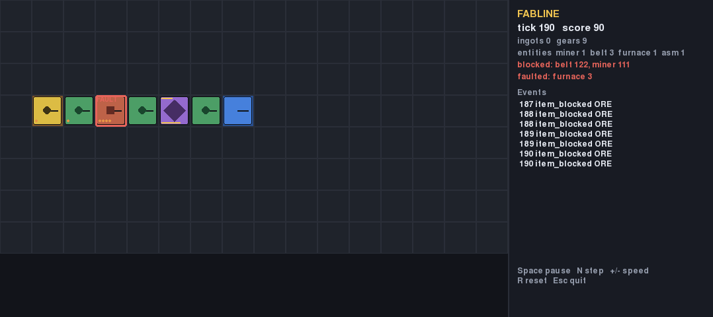

# Experiment 0008 — Opt-in machine faults

- **Status:** complete
- **Date:** 2026-11-21
- **Type:** engineering milestone plus a debug benchmark; not a pre-registered
  research experiment
- **World:** factory-0.1.0 + `FaultConfig`
- **Benchmark:** none; `factory-v0.1` unchanged
- **Sensor model:** `sensors` / `diagnostics` 0.1.0 (static). Superseded by
  0.2.0 dynamic channels in
  later work; this summary is
  historical and is not rewritten.

## What was built

- `FaultConfig`: opt-in wear, fault threshold, repair downtime.
- Entity wear/fault/repair fields.
- Auto-repair and fault events.
- `sensors` observation: H×W×5 wear/temperature/vibration/acoustic/faulted.
- `diagnostics` observation: 13 aggregate features.
- `factory.fault.predict.v1`: fault-within-50-ticks classification.
- Fault benchmark comparing the standard vector view to diagnostics.
- Fault replays carry the fault config; validation restores it.
- Viewer fault overlay with `render --faults`.
- Tests for fault mechanics, hashes, sensors, labels, replay, and benchmark.

## Results

Fault benchmark: 40 episodes, 1,440 samples per view, positive rate 0.306.

| view | method | test accuracy | balanced | macro F1 |
|---|---|---:|---:|---:|
| vector | majority | 0.694 | 0.500 | 0.410 |
| vector | GBDT | 1.000 | 1.000 | 1.000 |
| vector | MLP | 0.750 | 0.667 | 0.678 |
| diagnostics | majority | 0.694 | 0.500 | 0.410 |
| diagnostics | GBDT | 1.000 | 1.000 | 1.000 |
| diagnostics | MLP | 1.000 | 1.000 | 1.000 |

## Interpretation

- **The mechanic works as a data source.** Faults produce wear, downtime,
  sensor channels, and fault events.
- **Diagnostics help the neural baseline.** The MLP goes from 0.750 accuracy /
  0.667 balanced on the vector view to 1.000 on diagnostics.
- **GBDT solves both.** The vector view already carries enough production and
  entity-count signal; this is a debug task, not a hard benchmark.
- **The frozen benchmark is untouched.** Fault-free state hashes and the
  `factory-v0.1` benchmark are unchanged.
- **Auto-repair was the first simplification.** Experiment 0009 added the
  explicit repair action and a two-action recovery task.

## Caveats

- One fixed gear line, one threshold, one repair window.
- Faults are deterministic; no stochastic failure modes.
- Only furnaces/assemblers fault; belts and miners do not (miner wear is
  configurable but default zero).
- The fault prediction task is easy for GBDT.
- No held-out layouts or fault severities.

## Next

1. Repair action and fault-recovery control task.
2. Stochastic faults and sensor noise.
3. Fault view-arrival: add thermal/vibration/acoustic as new views and retest
   insertion and retention.
4. Power or multi-agent mechanics after the fault track is exhausted.

## Artifacts

- Task card: `docs/tasks/fault-prediction.md`
- Dataset card: `docs/datasets/fault-debug-v0.1.md`
- Mechanic RFC: `docs/rfcs/0001-faults.md`
- ADR: `docs/decisions/0011-faults-opt-in.md`
- Code: `src/fabline/worlds/factory/faults.py`, `obs/sensors.py`,
  `tasks/fault_prediction.py`, `harness/faults.py`
- Run: `make fault-benchmark`
