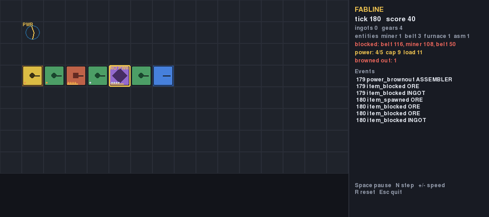

# Experiment 0015 — Power grid and brownout prediction

- **Status:** complete
- **Date:** 2026-11-21
- **Type:** engineering milestone plus a debug benchmark; not a pre-registered
  research experiment
- **World:** factory-0.1.0 + PowerConfig
- **Benchmark:** none; `factory-v0.1` unchanged

## Result in one paragraph

**The power grid works and the power view helps the neural baseline, but the
debug task is easy for GBDT.** An opt-in grid with pre-placed generators,
radius-based distribution, activity-gated demand, and brownouts is in. On
brownout-within-5-ticks prediction, the MLP improves from **0.763 accuracy /
0.743 balanced** on the vector view to **0.825 / 0.773** on the power view;
GBDT solves both views at 1.0. The mechanic is deterministic, fault-free hashes
are unchanged, and the frozen benchmark is untouched. Allocation control is not
implemented yet; it is the next phase.

## What was built

- `PowerConfig`, disabled by default and separate from `FactoryConfig`.
- Pre-placed generators as canonical infrastructure state, not entities.
- Manhattan-radius distribution with deterministic generator-id and consumer-id
  allocation.
- Activity-gated demand: miner 2 continuously; belt 1 while carrying; furnace 3
  while crafting; assembler 4 while crafting; depot 0.
- Brownouts stop miner output, crafts, and belt movement; transitions emit
  `power_brownout` and `power_restored`.
- Faulted machines demand no power and free capacity for others.
- `power` aggregate observation (12 features) and `power_grid` spatial
  observation `(H, W, 3)`.
- `factory.power.brownout.v1` task and `power-benchmark` CLI.
- Viewer `--power` overlay with generator markers, `NO PWR` outlines, and power
  telemetry.
- Replay and manifest carry the power config.
- Tests for placement, allocation, radius, brownouts, faults, observations,
  hashes, labels, replay, and the benchmark.

## Power configuration

Benchmark config:

- one generator, capacity 9, radius 8;
- fixed gear line;
- 40 episodes, 100-tick warmup, 5-tick sampling, 5-tick horizon.

The budget is tight: the full line's active demand is 10–12, so the assembler
or a belt is unpowered when too many machines work at once. Brownouts are
intermittent rather than permanent.

## Results

Power benchmark: 40 episodes, 3,200 samples per view, positive rate 0.366.

| view | method | accuracy | balanced | macro F1 |
|---|---|---:|---:|---:|
| vector | majority | 0.625 | 0.500 | 0.385 |
| vector | GBDT | **1.000** | **1.000** | **1.000** |
| vector | MLP | 0.763 | 0.743 | 0.745 |
| power | majority | 0.625 | 0.500 | 0.385 |
| power | GBDT | **1.000** | **1.000** | **1.000** |
| power | MLP | **0.825** | **0.773** | **0.792** |

## Interpretation

- **The mechanic is real.** Generators, coverage, activity-gated demand,
  brownouts, work stoppage, fault interaction, and replay all behave
  deterministically.
- **The power view adds signal for the MLP.** The 0.062 accuracy / 0.030
  balanced gain is in the same direction as the fault diagnostics result.
- **The task is easy for GBDT.** The vector view's tick and production history
  expose the load cycle, so GBDT solves both views. This is a debug task, not a
  hard benchmark.
- **The budget is a narrow regime.** Capacity 9 produces intermittent
  brownouts; capacity 10 or more removes them entirely. There is no smooth
  scarcity curve in this small line.
- **The frozen benchmark is untouched.** Power is opt-in; fault-free,
  power-free hashes and `factory-v0.1` are unchanged.
- **Control was phase 2.** It was completed as
  [`0016-power-allocation`](../0016-power-allocation/summary.md); this summary is
  the phase-1 record.

## Caveats

- One fixed gear line, generator layout, and budget.
- Generators are pre-placed infrastructure; they are not buildable.
- No wires/connectivity, fuel, batteries, or capacity degradation.
- The label is a new brownout transition, not sustained unpowered state.
- GBDT solves both views; the MLP is the view comparison.
- Small debug budgets; CIs are wide.
- The viewer overlay is functional, not polished.

## Next

1. **Power allocation control (phase 2):** completed as
   [`0016-power-allocation`](../0016-power-allocation/summary.md). A three-action
   priority scheduler; tabular Q reaches 116.67 score vs 0–10 for fixed
   policies.
2. **Power view-arrival:** treat the power grid as a new view over a production
   predictor and test insertion/retention.
3. **Buildable generators, fuel, or batteries:** later mechanics, each with its
   own pre-registration.

## Artifacts

- Mechanic: `src/fabline/worlds/factory/power.py`,
  `world.py`, `state.py`, `generator.py`
- Observations: `src/fabline/obs/power.py`
- Task: `src/fabline/tasks/power.py`
- Benchmark: `src/fabline/harness/power.py`
- Viewer: `docs/power-view.png`
- Task card: `docs/tasks/power-brownout.md`
- Dataset card: `docs/datasets/power-debug-v0.1.md`
- Run: `make power-benchmark`
