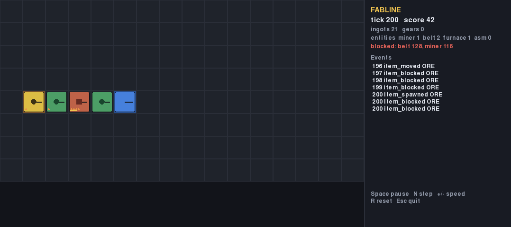

# Viewer, replay, and play

The renderer is a **read-only client** over the same simulation and benchmark
core. It never mutates state, and it is optional: the benchmark runs headless.



## Install

```bash
make render-install
# or
.tools/uv pip install --python .venv/bin/python -e ".[render]"
```

Pygame is not required for training, benchmarking, or tests that do not touch
the renderer.

## Watch a live factory

```bash
.venv/bin/python -m fabline render --config configs/factory_shared.toml
```

Controls:

- `Space` — pause / resume
- `N` — advance one tick
- `+` / `-` — faster / slower
- `R` — reset
- `Esc` — quit

The panel shows tick, score, deliveries, entity counts, blocked entities, and
the last events. The grid shows tiles, entities, items, craft progress, and
directions.

## Replay a shared episode

```bash
.venv/bin/python -m fabline render \
  --dataset results/factory-v0.1/dataset \
  --episode test_extra_gear_000034
```

The player reconstructs the world from the replay seed and scenario and runs it
at the requested speed. The factory-v0.1 dataset manifest carries the world
config, so `--config` is optional.

## Headless viewer QoL

Browse replay files and task cards without Pygame:

```bash
.venv/bin/python -m fabline replay-browser --root datasets --limit 20
.venv/bin/python -m fabline replay-browser \
  --show datasets/demo-control-v0.1/demos/scripted_0000/replay.json
.venv/bin/python -m fabline task-cards
.venv/bin/python -m fabline task-cards --show fault-calibration
```

The same actions are in `fabline wizard` under “browse replay files” and “view a
task card.” These commands are read-only; they do not tick or mutate a world.

## Screenshot (headless)

```bash
SDL_VIDEODRIVER=dummy .venv/bin/python -m fabline render \
  --config configs/factory_shared.toml \
  --screenshot docs/factory-view.png --ticks 220 --seed 2
```

Screenshot mode uses a dummy SDL video driver and does not open a window.

## Play the control task

```bash
.venv/bin/python -m fabline play --out datasets/human-control-v0.1
```

Build a working line on the highlighted six-tile path:

- `0` — noop
- `1` — miner
- `2` — belt
- `3` — furnace
- `4` — assembler
- `5` — remove the last path entity
- `S` — save the current demo and start a new episode
- `R` — retry the current seed
- `Esc` — quit

Saved demos use the same format as scripted demos. A demo records the control
observation before each action, the action, the reward, and a state hash after
each step, so it replays exactly.

## Scripted demos and behavior cloning

```bash
.venv/bin/python -m fabline demo \
  --episodes 10 --out datasets/demo-control-v0.1
.venv/bin/python -m fabline human-bc \
  --dataset datasets/demo-control-v0.1 --out results/human-bc
```

The scripted demos are a pipeline check, not a human-data claim. Use
`fabline play` to collect human demos, then point `human-bc` at that dataset.

## Read-only guarantees

- The viewer receives a state and draws it; it does not call `tick`, `step`, or
  any mutation method.
- The replay viewer creates its own world from the replay seed and scenario.
- The play client uses the same `ControlEnv` and action contract as the
  benchmark; it records, it does not bypass the environment.
- Benchmark code does not import the renderer.

## Tests

- `tests/unit/test_render.py` checks that rendering leaves the state hash
  unchanged and that screenshot mode writes a file.
- `tests/unit/test_human_demos.py` checks demo round-trips, replay validation,
  and behavior cloning.
- `tests/integration/test_cli_m4.py` runs the demo and human-BC commands.
- `tests/unit/test_browser.py` and `tests/unit/test_wizard.py` cover replay
  listing, task-card lookup, and the wizard menu paths.
